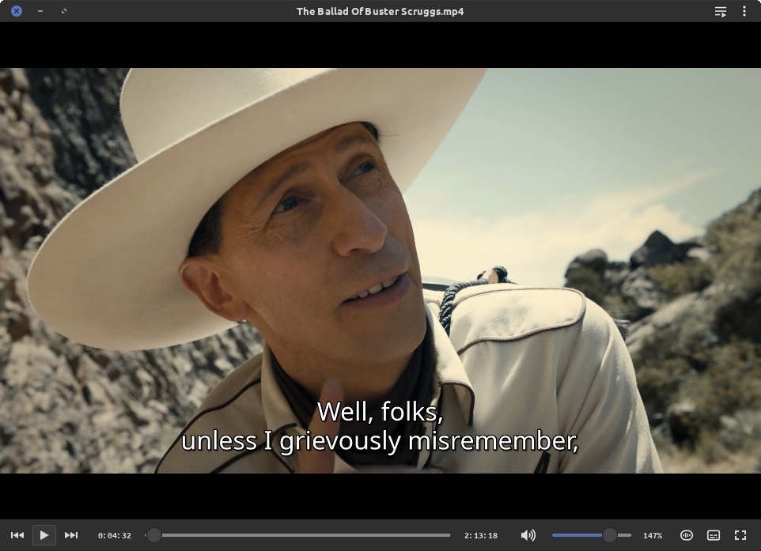

# Mint-L Dark Blue for VLC — Plus

The Mint-L Dark Blue VLC skin, bundled with a patched skins module that fixes the mouse cursor and adds subtitle and audio track buttons.

<p align="center">
  
</p>

<p align="center">
  <a href="https://github.com/RogerBytes/vlc-mint-l-dark-blue-plus/releases/latest"></a>
  <a href="LICENSE"></a>
</p>

<p align="center">
  <a href="https://github.com/RogerBytes/vlc-mint-l-dark-blue-plus/releases/latest">Latest release</a> ·
  <a href="#installation">Installation</a> ·
  <a href="#building-from-source">Build</a> ·
  <a href="https://github.com/RogerBytes/vlc-mint-l-dark-blue-plus/issues">Issues</a>
</p>

**Mint-L Dark Blue for VLC — Plus** is a `.deb` package that replaces VLC's skins module (`vlc-plugin-skins2`) with a patched build and installs the Mint-L Dark Blue skin as VLC's default skin. It is the extended version of [Mint-L Dark Blue for VLC](https://github.com/RogerBytes/vlc-mint-l-dark-blue), which works with an unmodified VLC.

> [!WARNING]
> The package is built for **Linux Mint 22 / Ubuntu 24.04** (VLC 3.0.20). It replaces the `vlc-plugin-skins2` package; VLC itself keeps receiving its normal updates, and the module keeps working with any VLC 3.0.x update of the distribution (same plugin ABI). Do not install it on another distribution.

## Features

- **Mouse cursor auto-hide**: the cursor disappears after a second of inactivity over the video, in window and fullscreen mode (the stock VLC 3 skins module never implemented it on Linux).
- **Resize cursors** over the skin's resize areas.
- **Steady fullscreen panel**: it no longer flashes at the top of the screen for a split second before reaching its place.
- **Mouse wheel over the video** changes the volume, in window and fullscreen mode (like the rest of the skin; follows VLC's mouse wheel setting).
- **Tooltips in your language**: the skin is written in English and VLC shows its tooltips with its own translations. The window buttons have no tooltip, like native Cinnamon windows.
- **Inactive window state**: like native Cinnamon windows, the close button turns grey and the window buttons dim when VLC is not the focused window.
- **Subtitle and audio track buttons** that cycle tracks like the `V` and `B` hotkeys, with VLC's usual on-screen message.
- **Mint-L Dark Blue skin** installed as VLC's default skin, plus a variant with the window buttons on the right.
- Native-looking title bar (real Mint-L window buttons, centred file name, double-click to maximize), flat modern controls, stretchable progress bar, dynamic volume icon, and a floating fullscreen panel.
- Survives VLC updates: the package owns its files, so apt never overwrites them.

## Installation

<details><summary class="button">🔍 Spoiler</summary><div class="spoiler">

Download the `.deb` file from the [releases page](https://github.com/RogerBytes/vlc-mint-l-dark-blue-plus/releases), then:

```bash
sudo apt install -y ./vlc-plugin-skins2-mint-l_*.deb
```

apt removes `vlc-plugin-skins2` and installs this package in its place.

Then turn the skin on, **once per user**, with one of these:

- **Script** (from this repository, run as your normal user, VLC closed):

  ```bash
  ./tools/enable-skin.sh          # window buttons on the left
  ./tools/enable-skin.sh right    # window buttons on the right
  ```

- **By hand**: **Tools → Preferences → Interface**, select **Use custom skin**, leave **Skin resource file** empty (the default skin is used) or pick `/usr/share/vlc/skins2/Mint-L-Dark-Blue-Right.vlt`, click **Save** and restart VLC.

- **Without changing any setting**: start VLC with the `svlc` command.

**Uninstall** (restores the original VLC skins module):

```bash
sudo apt install -y vlc-plugin-skins2
```

</div></details>

## Dark right-click menus

The right-click menu, the playlist and the preferences window are drawn by VLC's Qt interface, not by the skin. To make them dark too, Qt applications must follow your GTK theme.

<details><summary class="button">🔍 Spoiler</summary><div class="spoiler">

Install the GTK integration for Qt 5 if it is missing:

```bash
sudo apt install -y qt5-style-plugins
```

Test it once:

```bash
QT_STYLE_OVERRIDE=gtk2 QT_QPA_PLATFORMTHEME=gtk2 vlc
```

If the right-click menu is dark, make it permanent (the settings are appended, so they override any previous value), then log out and back in:

```bash
printf '\n# Qt apps follow the GTK theme (Mint-L-Dark-Blue)\nexport QT_QPA_PLATFORMTHEME=gtk2\nexport QT_STYLE_OVERRIDE=gtk2\n' >> ~/.profile
```

</div></details>

## Building from source

<details><summary class="button">🔍 Spoiler</summary><div class="spoiler">

The build runs in a Docker container (Ubuntu 24.04), so nothing is installed on your system. It downloads the exact VLC sources of the distribution, applies the patch, compiles the skins module and assembles the `.deb` from the original `vlc-plugin-skins2` package.

```bash
./packaging/build.sh
```

The `.deb` and the two `.vlt` skins end up in `dist/`.

To build against another VLC version of the same distribution, set it explicitly:

```bash
VLC_VERSION=3.0.20-3build6 PKG_REV=7 ./packaging/build.sh
```

Repository layout:

- `skin/` — sources of the two skins (`theme.xml` and images)
- `patch/` — the patch applied to VLC's skins module
- `packaging/` — Dockerfile and build scripts
- `tools/` — `enable-skin.sh`

</div></details>

## The patch

<details><summary class="button">🔍 Spoiler</summary><div class="spoiler">

[`patch/vlc-3.0-skins2-cursor-and-tracks.patch`](patch/vlc-3.0-skins2-cursor-and-tracks.patch) changes about 190 lines of VLC's `modules/gui/skins2`:

- **Cursor handling on X11**: backport of the implementation already present in VLC 4 (`X11Factory::changeCursor`, empty cursor and Xcursor themed cursors). In VLC 3 this function is an empty `TODO`.
- **Two new skin commands**: `vlc.subtitleTrack()` and `vlc.audioTrack()`, which trigger the same actions as the `V` and `B` hotkeys.
- **Mouse wheel over the video**: the video window now forwards the wheel to VLC as a hotkey, like the rest of the skin already did (volume by default, `hotkeys-y-wheel-mode`). The stock module ignored it.
- **Translated tooltips**: skin tooltips are looked up in VLC's own translations (`Text`, `Text (Key)` and `Text $VAR` forms), so an English skin shows them in the user's language.
- **Window focus**: a new skin variable, `<window>.isFocused`, tells whether a skin window has the keyboard focus (focus moves inside the window, e.g. to the video, are ignored). The skin uses it to grey out the window buttons.
- **Window placement**: windows are now positioned before being shown, and the skin windows tell the window manager that their position is set by the program (`USPosition`/`PPosition`). Without this, the window manager placed the fullscreen panel itself (centred at the top of the screen) each time it reappeared, until VLC moved it back. The main window still reopens where it was last closed.

A skin using these commands and this variable still loads on an unpatched VLC: the two track buttons are simply skipped, the window buttons stay in their focused colours and the tooltips stay in English.

</div></details>

## Known limitations

<details><summary class="button">🔍 Spoiler</summary><div class="spoiler">

These come from VLC's skin engine (skins2):

- The window can only be resized from the bottom-right corner and the bottom edge.
- The window cannot be dragged by the video area while playing: use **Alt + drag**, which also enables Cinnamon's edge snapping.
- The fullscreen panel can only be made transparent as a whole: **Tools → Preferences → All → Interface → Main interfaces → Qt → Fullscreen controller opacity**.

</div></details>

## License and credits

The skin is licensed under GPL-3.0 (see [`LICENSE`](LICENSE)). The patch modifies VLC code and is distributed under VLC's license (GPL-2.0-or-later). Full details in [`CREDITS.md`](CREDITS.md).

## Author

[](https://github.com/RogerBytes)
[**RogerBytes (Harry Richmond)**](https://github.com/RogerBytes)

This project was developed with the help of an AI (Claude, by Anthropic). The author decides what it does, tests it and maintains it.

<span hidden>
<details><summary></summary>
<style>.spoiler{border-left:4px solid #1abc9c;border-bottom-left-radius:3px;padding-left:10px;padding-top:15px;margin-top:-10px;margin-bottom:15px}.button{cursor:pointer;padding:5px 10px;background-color:#3498db;color:white;border-radius:3px;margin-bottom:5px;display:inline-block;transition:background-color 0.2s}.button:hover{background-color:#217dbb}details[open] .button{background-color:#1abc9c}</style>
</details></span>

<p align="right"><a href="#mint-l-dark-blue-for-vlc--plus">🔝 Back to top</a></p>
